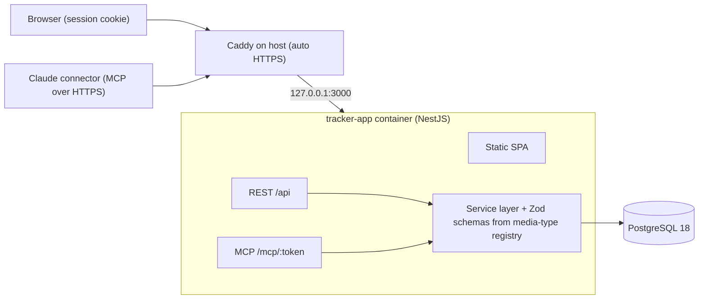

# Personal Tracker — Build Plan

Oct 16, 2026 · Max

> **For the coding agent:** this is the source of truth for the project. Work milestone by milestone (see "Milestones"), starting with milestone 1, and stop for review after each one. Decisions listed at the end are final; if something in the plan is ambiguous or contradicts itself, ask instead of guessing. Never commit secrets — everything sensitive goes into `.env` (provide `.env.example`).

## Goal & scope

One place to track what I want to watch or read, what I'm on now, and what I've finished — replacing Telegram saved messages for movies and books. v1 ships movies and books, a web UI, and an MCP endpoint so I can dictate entries to Claude.

**In v1**

- Two media types: movies and books
- Three statuses per item: Planned, In progress, Done (plus Dropped, cheap to add now)
- Web UI: lists, quick add, edit status, rating and notes; covers auto-picked from TMDB / Open Library and editable
- MCP server connected to Claude as a custom connector
- Single user, deployed on my Hetzner box

**Later, not v1**

- Anime (and importing my existing list from that app)
- TV series, games, podcasts — any new type should be a config change, not a migration
- Richer metadata (genres, cast, page counts) from the same providers
- Stats: finished per month, time to finish

**Design rule:** adding a new media type must touch one registry file and zero database tables.

## Architecture

One Node process serves the built React app, the REST API and the MCP endpoint, so the web UI and Claude share the exact same validation and database code.



The REST API and MCP tools are thin adapters over one service layer; only Postgres holds state.

## Tech stack

Stick to the TypeScript stack I already know, keep it to one deployable service, and pick tools that stay small on a cheap VPS.

| Layer | Pick | Why |
| --- | --- | --- |
| Toolchain | Vite+ (`vp` CLI, beta) | One tool for dev, build, test (Vitest), lint (Oxlint), format (Oxfmt) and monorepo tasks, configured from one `vite.config.ts` |
| Frontend | React + TypeScript, built by Vite+ | Static build, no SSR needed for a private app |
| UI kit | Radix Themes (+ Radix Primitives where needed) | Polished defaults, dark mode, accessible; Themes gives the look, Primitives give escape hatches |
| Data fetching | TanStack Query | Caching + optimistic updates make status changes feel instant |
| Routing | TanStack Router or React Router | Typed routes per media type |
| Backend | NestJS | Familiar; guards, modules and `@nestjs/throttler` cover auth and rate limits |
| MCP | `@modelcontextprotocol/sdk`, Streamable HTTP, mounted in a Nest controller at `/mcp` | Official SDK, same process as the API |
| ORM | Drizzle | Typed schema, plain SQL migrations, tiny runtime |
| Database | PostgreSQL 18 | Native `uuidv7()`, JSONB + full-text search cover the flexible-fields problem |
| Validation | Zod | One schema shared by API, MCP tool inputs and forms |
| Repo | pnpm monorepo run through Vite+ tasks: `apps/web`, `apps/server`, `packages/shared` | Shared types and the media-type registry live in one place |

Vite+ is in beta (v0.2.x, MIT), so pin its version. NestJS keeps its own `nest build` (SWC) because it needs decorator metadata; Vite+ still runs the server's tests through Vitest with `unplugin-swc`, plus lint and format across the whole repo. With 8 GB RAM, Postgres 18 next to the portfolio project is no concern.

## Data model

One `items` table for every media type, with common columns as real columns and type-specific fields in a JSONB `meta` column validated by a per-type Zod schema. New type = new registry entry, no migration.

```sql
create extension if not exists pg_trgm;
create type item_status as enum ('planned', 'in_progress', 'done', 'dropped');

create table items (
  id           uuid primary key default uuidv7(),
  type         text not null,            -- 'movie' | 'book' | later 'anime'...
  title        text not null,
  status       item_status not null default 'planned',
  rating       smallint check (rating between 1 and 10),
  notes        text,
  tags         text[] not null default '{}',
  meta         jsonb not null default '{}', -- year, director, author, pages, episodes...
  source       text not null default 'web', -- 'web' | 'mcp'
  cover        jsonb,                    -- {source, ref, locked}; null = no cover yet
  external_ref text,                     -- 'tmdb:438631' | 'ol:OL893415W'
  started_at   timestamptz,
  finished_at  timestamptz,
  created_at   timestamptz not null default now(),
  updated_at   timestamptz not null default now(),
  search       tsvector generated always as (
                 to_tsvector('simple', title || ' ' || coalesce(notes, ''))
               ) stored
);

create index on items (type, status, updated_at desc);
create index on items using gin (search);
create index on items using gin (title gin_trgm_ops); -- fuzzy match for MCP lookups
```

The media-type registry in `packages/shared`:

```ts
export const mediaTypes = {
  movie: {
    label: 'Movies', icon: 'film', lookup: 'tmdb',
    statusLabels: { planned: 'Want to watch', in_progress: 'Watching', done: 'Watched' },
    meta: z.object({ year: z.number().optional(), director: z.string().optional() }),
  },
  book: {
    label: 'Books', icon: 'book', lookup: 'openlibrary',
    statusLabels: { planned: 'Want to read', in_progress: 'Reading', done: 'Read' },
    meta: z.object({ author: z.string().optional(), pages: z.number().optional() }),
  },
} satisfies Record<string, MediaTypeDef>;
```

The UI, API validation and MCP tool descriptions are all generated from this object, so adding `anime` later is \~10 lines.

Use the `simple` text-search config, not `english`, since titles may be in Ukrainian or Japanese romaji.

## Auth (single user)

There is exactly one account, defined by env vars — no signup, no users table. The web app and the MCP endpoint use two different mechanisms because Claude's custom connectors authenticate via OAuth.

**Web UI**

- `ADMIN_PASSWORD_HASH` (argon2) in `.env`; a `/login` page posts the password
- On success, set an `httpOnly`, `Secure`, `SameSite=Lax` session cookie (signed JWT or a row in a `sessions` table), 30-day expiry
- Every `/api/*` route checks the cookie; everything else serves the static SPA
- Login is rate-limited hard (5 attempts / 15 min per IP)

**MCP connector — two options**

| Option | How it works | Effort | Security |
| --- | --- | --- | --- |
| A. Secret URL (start here) | Endpoint lives at `/mcp/<64-char random token>`; connector added with no auth | 15 min | Fine for a personal list; the URL is the password, so never paste it anywhere |
| B. Minimal OAuth 2.1 (upgrade) | App acts as its own authorization server: metadata at `/.well-known/oauth-authorization-server` and `/.well-known/oauth-protected-resource`, dynamic client registration, `/authorize` shows the same password login, issues a bearer token | 1–2 evenings | Proper: tokens revocable, nothing secret in the URL |

For option B, the MCP TypeScript SDK ships auth router helpers, and Claude's redirect URIs to allow are `https://claude.ai/api/mcp/auth_callback` and `https://claude.com/api/mcp/auth_callback`. Decision: option A. B stays documented in case the connector ever needs per-device, revocable access.

### How it flows in NestJS

**Web login**

1. Browser hits `track.kinqbert.space`; the SPA calls `GET /api/me`, gets 401, shows the login screen
2. `POST /api/auth/login` with the password; `AuthService` checks it against `ADMIN_PASSWORD_HASH` with argon2
3. On success, Nest sets a signed `httpOnly` session cookie (JWT with 30-day expiry, secret in `SESSION_SECRET`)
4. A global `SessionGuard` checks that cookie on every `/api/*` route; `@Public()` marks the few open ones (login, health)
5. `POST /api/auth/logout` clears the cookie; rotating `SESSION_SECRET` logs out every device

**Claude connector, option A (secret URL)**

1. In Claude: Settings → Connectors → Add custom connector, URL `https://track.kinqbert.space/mcp/<MCP_TOKEN>`
2. An `McpTokenGuard` compares the path token with `MCP_TOKEN` in constant time; mismatch returns 404, not 401, so the endpoint looks absent
3. Leaking the URL = rotate `MCP_TOKEN` and re-add the connector

**Claude connector, option B (OAuth)**

1. Claude calls `/mcp` without a token, gets 401 pointing to `/.well-known/oauth-protected-resource`
2. Claude reads the metadata, registers itself as a client (dynamic client registration), and opens `/oauth/authorize` in my browser
3. That page is the same password login; after it, Nest redirects back to Claude's callback with a one-time code
4. Claude exchanges the code (with PKCE) at `/oauth/token` for an access token + refresh token
5. Every MCP call carries `Authorization: Bearer <token>`; a `BearerGuard` validates it. Tokens live in a small `oauth_tokens` table, so revoking = deleting a row

## MCP server

Seven tools cover dictation: "add Dune to books I want to read", "I finished Oppenheimer, 8/10", "what movies are on my list?". The tools call the same service layer as the REST API, so there is one source of truth for validation.

| Tool | Input | Returns | Notes |
| --- | --- | --- | --- |
| `add_item` | `type`, `title`, `status?`, `meta?`, `notes?`, `tags?` | the created item + the matched title/year of its cover | Fuzzy-match existing titles first (trigram > 0.6) and return `possible_duplicate` instead of creating; the reply lets me catch a wrong match |
| `update_item` | `id` or `title` + `type`, any of `status`, `rating`, `notes`, `meta` | the updated item | Setting `done` fills `finished_at`; `in_progress` fills `started_at` |
| `list_items` | `type?`, `status?`, `limit?` (default 20) | compact list: id, title, status, rating | Short output keeps Claude's context small |
| `search_items` | `query` | top 10 matches with ids | Full-text + trigram fallback |
| `find_covers` | `id`, `query?` | top 5 candidates: ref, title, year or author, image URL | For "wrong poster, use the 2021 one" |
| `set_cover` | `id`, `ref` or `url` | the updated item | Locks the cover against auto-lookup |
| `delete_item` | `id` | confirmation | Destructive — tool description tells Claude to confirm with me first |

Tool details:

- `type` is a Zod enum built from the registry, so Claude sees the allowed types in the tool schema
- Tool descriptions carry the status wording per type ("planned = want to watch") so dictation maps cleanly
- Mark `list_items` and `search_items` with `readOnlyHint`, `delete_item` with `destructiveHint`
- Transport: Streamable HTTP, stateless mode (no session store needed)
- Every MCP write gets `source = 'mcp'`, so the UI can show a small badge and I can spot mis-heard titles

Optional later: an MCP resource `tracker://summary` with counts per type and status.

## Covers & lookup

Every new movie or book gets a cover automatically: the server searches TMDB (movies) or Open Library (books), picks the best match, and stores a reference. I can swap it any time from a picker, paste a URL, or upload my own.

| Type | Provider | Key | Limits & terms |
| --- | --- | --- | --- |
| Movies | [TMDB](https://developer.themoviedb.org/docs/faq) `/3/search/movie` → `poster_path` | Free key for non-commercial use (v4 read token as Bearer) | Must credit TMDB with their logo in an About/Credits page; their terms also cap how long TMDB data may be cached (6 months) |
| Books | [Open Library](https://openlibrary.org/dev/docs/api/covers) `search.json` → `cover_i` | None; send a User-Agent with my contact email | Covers by cover ID are not rate-limited; by ISBN 100 per 5 min per IP. Link back appreciated |
| Books, fallback | Google Books volumes API | Optional | \~1,000 requests/day without a key; better for Ukrainian editions |

**Auto-pick (on create, from web or MCP)**

1. `LookupService` gets the provider from the media-type registry and searches by title, plus year (movies) or author (books) when given
2. Each candidate gets a score: title similarity + bonus for matching year/author + bonus for having an image; TMDB popularity breaks ties
3. Best score above the threshold → save `cover` and `external_ref`, and fill empty `meta` fields (year, director, author)
4. Below the threshold or no results → save without a cover; the item shows a "Pick cover" prompt
5. Lookup runs inline with a 3 s timeout; on timeout the item saves anyway and a background retry fills the cover

**Manual edit**

- `GET /api/lookup?type=movie&q=dune` returns the top 12 candidates with thumbnails
- Item drawer → Change cover → grid of candidates, plus Paste URL and Upload tabs
- `PATCH /api/items/:id/cover` with `{source, ref}` or `{source: 'url', url}`; uploads go to an `uploads` volume, resized to WebP with `sharp`
- Any manual choice sets `cover.locked = true`, so automatic lookup never overwrites it

**Display**

- `cover` stores `{source, ref, locked}`; the image URL is built at render time — TMDB `w185`/`w500`, Open Library `-M`/`-L` by cover ID — and loads straight from their CDNs
- Fixed 2:3 aspect box with `loading="lazy"`, so no layout shift; title initials as the placeholder
- Lookup results cached for 24 h to stay polite to the APIs

## UI

Three screens and one command palette cover v1. Radix Themes handles the look; the work is in a calm layout and fast interactions.

**Screens**

1. **Home** — per type, a row with counts (e.g. Movies: 24 planned · 1 watching · 61 watched) and the 5 latest items
2. **List view** (`/movies`, `/books`) — `Tabs` for Planned / In progress / Done / Dropped, search field, sort by added / updated / rating; each row has a status `Select` and a rating control inline
3. **Item drawer** — `Dialog` (side sheet style) with title, status, rating, notes, tags, type-specific fields generated from the Zod meta schema, and the cover with a Change button that opens the cover picker
4. **Quick add** — `Cmd+K` palette: type a title, pick type with Tab, Enter saves as Planned

**Radix pieces:** `Theme` (accent: iris or jade, radius: large, appearance follows system), `Card`, `Tabs`, `Select`, `Dialog`, `DropdownMenu`, `Badge` for status and the MCP source mark, `Toast` from Primitives for undo.

**Performance**

- Static SPA served by NestJS (behind Caddy) with long-cache hashed assets; first load under \~150 KB gzipped is realistic
- Route-level code splitting per media type
- TanStack Query optimistic updates: status change feels instant, rolls back on error
- Lists render plain until \~500 items; add `@tanstack/react-virtual` only if a list gets long
- Undo toast instead of confirm dialogs for status changes and deletes

**Aesthetic notes:** generous spacing, one accent color, a poster grid view plus a compact list view with small thumbnails, subtle status colors via `Badge` variants.

## Deployment (Hetzner)

The tracker runs as its own Docker Compose project (app + Postgres 18) at `track.kinqbert.space`, sharing the 8 GB Hetzner box with the portfolio project. Exactly one reverse proxy may own ports 80/443: the portfolio already sits behind Caddy, so the tracker is one more site block in that Caddyfile. Caddy gives automatic HTTPS, which Claude's connector requires anyway.

DNS: an `A` record `track` → the server's IP. The Caddy site block:

```
track.kinqbert.space {
  encode zstd gzip
  request_body { max_size 1MB }
  reverse_proxy 127.0.0.1:3000
}
```

Caddy runs directly on the host (not in Docker), so the app publishes its port on localhost only: Caddy reaches `127.0.0.1:3000`, the internet doesn't. Add the block to `/etc/caddy/Caddyfile`, then `sudo systemctl reload caddy` — the portfolio keeps running untouched.

```yaml
# tracker/compose.yaml — Caddy lives on the host, outside Docker
services:
  app:
    image: ghcr.io/<me>/tracker:latest
    container_name: tracker-app
    env_file: .env
    ports: ["127.0.0.1:3000:3000"]  # localhost only, never 0.0.0.0
    depends_on: [db]
    mem_limit: 512m
  db:
    image: postgres:18-alpine
    env_file: .env
    command: postgres -c shared_buffers=256MB
    volumes: [pg_data:/var/lib/postgresql]  # PG 18 images mount the parent dir, not /data
    mem_limit: 1g
volumes: { pg_data: {} }
```

**Pipeline:** push to `main` → GitHub Actions builds one image (web build copied into the server's `public/`) → pushes to GHCR → SSH step runs `docker compose pull && docker compose up -d`; Drizzle migrations run on app start.

**Basic protection (enough for now)**

- Hetzner Cloud Firewall: allow only 22, 80, 443; SSH key-only, password login off
- Postgres not exposed — no published port, only reachable on the Compose network
- App-level rate limit: \~100 req/min per IP globally, 5/15 min on `/login` (`@nestjs/throttler`)
- Caddy request body limit (e.g. 1 MB) and timeouts
- Optional: put the domain behind Cloudflare's free proxy for real DDoS absorption — the only thing that actually stops volumetric attacks on a small VPS

**Backups:** nightly `pg_dump | gzip` via cron to a Hetzner Storage Box or any S3 bucket, keep 14 days. Test a restore once.

## Milestones

Six small milestones, each shippable on its own; dictation works from milestone 3.

1. **Skeleton** — monorepo, Drizzle schema + migration, registry with movie and book, REST CRUD, Zod shared types
2. **Deploy early** — Dockerfile, Compose, Caddy, domain, GitHub Actions; a blank "hello" behind login on the real server
3. **MCP v1** — seven tools with auto-cover lookup, secret-URL auth, connect in Claude, dictate the first entries
4. **UI v1** — home, list view, item drawer, Cmd+K quick add, optimistic updates
5. **Hardening** — rate limits, backups + restore test, a one-command MCP token rotation
6. **Migrate** — move the Telegram saved-messages lists in (paste into Claude and let it call `add_item`, or a one-off import script)

After that: anime as the first new registry entry, then richer metadata from the same providers.

## Open questions

- [ ] Register a TMDB account and request a free API key (goes into `.env` as `TMDB_TOKEN`, never into the repo)

Decided: NestJS · Postgres 18 · Vite+ · secret-URL MCP auth · existing host Caddy stays · `track.kinqbert.space` · rating 1–10 · statuses Planned / In progress / Done / Dropped.
